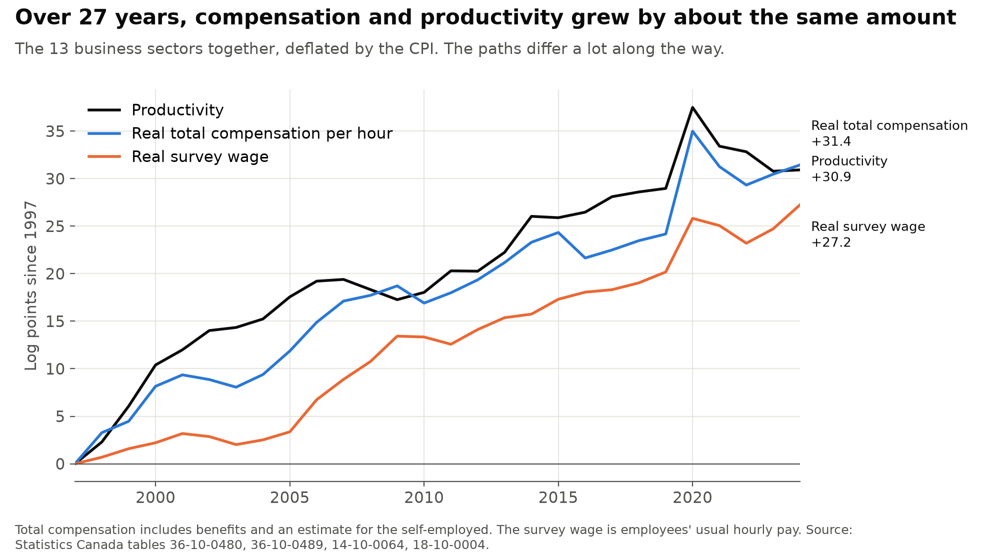
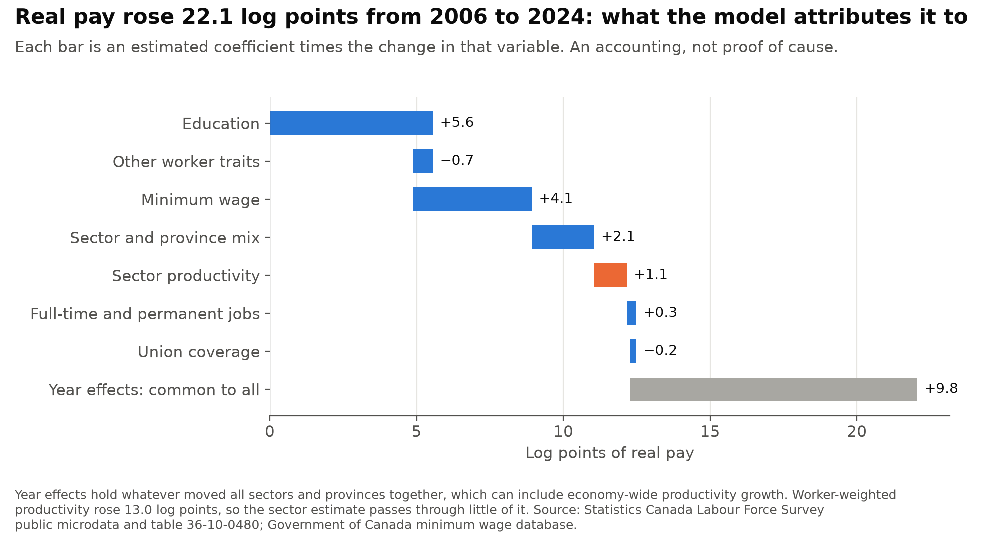
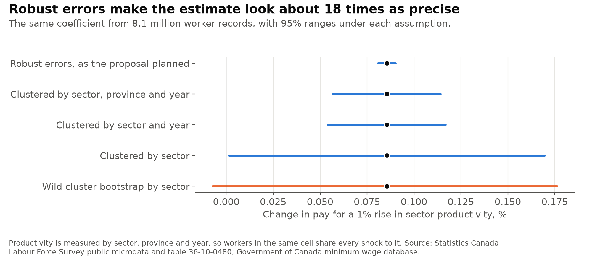
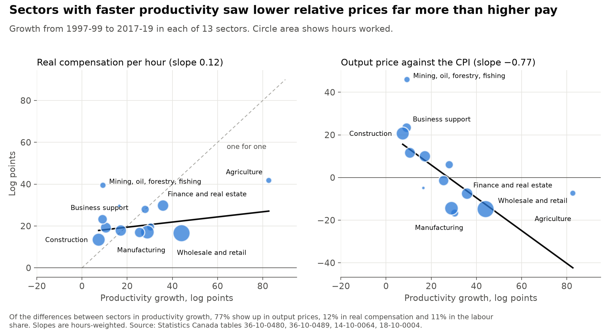
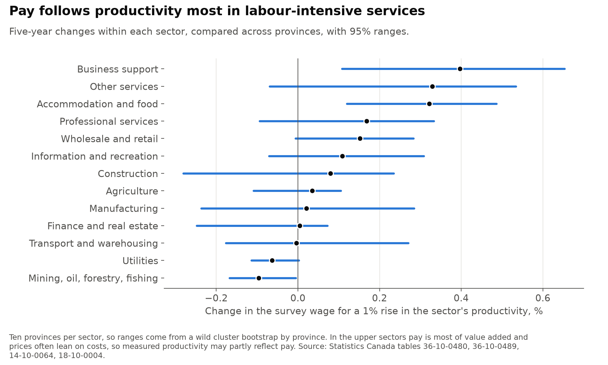
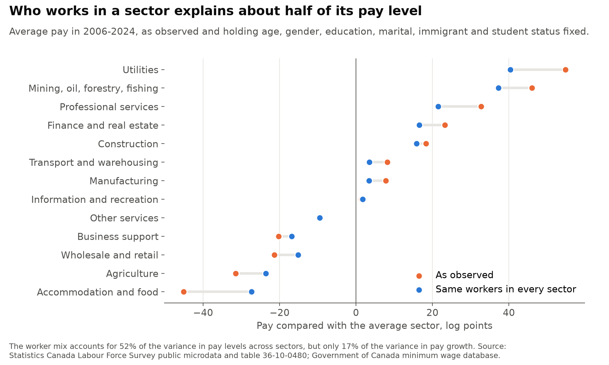

# canada_productivity_wages

[](https://github.com/atamalfuzi/canada_productivity_wages/actions/workflows/tests.yml)

How closely pay in Canada follows productivity, in 13 business sectors and 10 provinces, using open Statistics Canada tables for 1997 to 2024 and 8.1 million public survey records of employees for 2006 to 2024. Python, with pandas and SciPy.

This began as a proposal for my labour economics course at Simon Fraser University. It had no results, because it depended on restricted survey access through the Canadian Research Data Centre Network. This version answers its three questions from open data and changes parts of its design, listed [below](#changes-from-the-proposal).

Results are as of November 2026.

> **Personal project.** This is my own analysis of publicly available data. It is not associated with my work for any current or past employer and does not represent their views.

| Question | Methods | Answer |
|---|---|---|
| [How much of wage gains come from productivity?](#1-how-much-of-wage-gains-come-from-productivity) | Growth accounting, panel with sector and province-year effects, wild cluster bootstrap | Across all 13 sectors, productivity and real compensation both rose about 31 log points from 1997 to 2024, though compensation was well behind until 2019. Within a sector and province, pay barely follows its own productivity: −0.01% for a 1% rise (−0.06 to 0.04). |
| [Is productivity the main driver?](#2-is-productivity-the-main-driver) | Worker regression, decomposition of the change in pay | Not one the data can isolate. Of the 22 log point rise in pay from 2006 to 2024, sector productivity accounts for 5%, or about half if every trend common to all sectors is also credited to productivity. Education accounts for 25% and minimum wages for 18%. |
| [Why do sectors differ?](#3-why-do-sectors-differ) | Variance split, sector estimates, worker-mix adjustment | Differences in productivity growth mostly show up in relative prices (77%), with 12% in pay. Who works in a sector explains 52% of pay level differences but 17% of pay growth differences. |

A log point is about 1% for small changes; 31 log points is a rise of 36%. Ranges are 95%.

None of these are causal estimates. [What the design can and can't identify](#what-this-can-and-cant-identify) explains why.

## What it shows

### 1. How much of wage gains come from productivity?



The accounting has no estimation in it. Real survey pay equals productivity plus the changes in five other terms, and the terms add up exactly:

| Log points | 1997-2024 | 1997-2019 | 1997-2007 | 2007-2019 | 2019-2024 |
|---|---:|---:|---:|---:|---:|
| **Real survey wage** | **27.2** | **20.2** | **8.9** | **11.3** | **7.1** |
| Productivity | 30.9 | 29.0 | 19.4 | 9.6 | 1.9 |
| Labour share | | −2.9 | −6.5 | 3.6 | |
| Output prices against the CPI | | −1.9 | 4.2 | −6.1 | |
| Labour share and output prices together | 0.5 | −4.8 | −2.3 | −2.5 | 5.3 |
| Benefits | −2.1 | −0.4 | 0.5 | −0.9 | −1.7 |
| Self-employed income | −3.6 | −2.9 | −1.7 | −1.3 | −0.7 |
| Survey against national accounts | 1.6 | −0.6 | −7.0 | 6.4 | 2.2 |
| *Real total compensation* | *31.4* | *24.2* | *17.1* | *7.1* | *7.3* |

Nominal value added by industry stops at 2021, so the labour share and output prices can only be split up to then. After 2021 only their sum is known.

Productivity matched compensation over the whole period, in line with Williams (2021), who finds the two broadly aligned in Canada since 1961. The match depends on the end date. Through 2019, compensation rose 24.2 log points against 29.0 for productivity. The gap closed after 2019, when compensation rose 7.3 and productivity 1.9, and I can't tell yet whether that lasts. Productivity jumped 8.5 log points in 2020. About 5.9 of that happened within sectors, where hours fell faster than output, and 2.6 came from hours shifting away from low-productivity sectors.

Following Feldstein (2008), I compare compensation and productivity in the same prices. Measured in output prices, compensation rose 26.1 from 1997 to 2019, or 90% of productivity growth. Faster growth in benefits than in wages accounts for 2.1 log points over 27 years. It matters more in some sectors: 8.3 in manufacturing and 7.4 in utilities from 1997-99 to 2017-19.

The survey and the national accounts disagree a good deal over shorter periods, by 7 log points in 1997-2007 and in the other direction after. The survey records usual pay as reported by households, and the national accounts draw on employer and tax records. These data can't say which is closer in any one period.

Five-year changes in the totals don't move together much. Real compensation has a slope of 0.19 on productivity (−0.07 to 0.44), and the survey wage has −0.39 (−0.73 to −0.05). The link shows up over the full period more than in medium-run swings.

**Within sectors.** Comparing a sector and province with others in the same province and year, over five-year changes:

| Pay measure, change for a 1% rise in productivity | Deflated by the CPI | 95% range | Deflated by the sector's own output price | 95% range |
|---|---:|---:|---:|---:|
| Survey hourly wage | −0.01% | −0.06 to 0.04 | 0.41% | 0.13 to 0.62 |
| National accounts wage rate | 0.11% | 0.05 to 0.24 | 0.52% | 0.27 to 0.72 |
| Employee compensation per hour | 0.14% | 0.08 to 0.29 | 0.55% | 0.29 to 0.76 |
| Total compensation per hour | 0.15% | 0.08 to 0.31 | 0.56% | 0.31 to 0.75 |

Three things separate these numbers:

- **Shared hours.** National accounts pay per hour and productivity divide by the same hours, so an error in hours pushes both the same way. The survey wage doesn't share them, and it is the row closest to zero. That is why I treat it as the main estimate.
- **Shared prices.** Real productivity divides by the sector's output price, and so does the right-hand column. Part of the higher slope is a real effect, since a sector with faster productivity sees its relative price fall. Part may be errors in the price showing up on both sides.
- **Where the gain goes.** The identity gives a direct split. Over five years, a 1% rise in a sector's productivity comes with 0.14% more real compensation, 0.44% less labour share and 0.42% lower relative price.

Ten-year changes give about the same answers, and so do these samples:

| Survey wage, five-year changes | Slope | 95% range |
|---|---:|---:|
| All | −0.01 | −0.06 to 0.04 |
| Windows ending by 2019 | −0.03 | −0.10 to 0.02 |
| Without mining, oil, forestry, fishing | −0.00 | −0.06 to 0.05 |
| Without agriculture | −0.02 | −0.07 to 0.04 |
| Four largest provinces | 0.00 | −0.05 to 0.07 |
| Canada-wide sector panel | −0.06 | −0.21 to 0.11 |
| Survey files 2006-2024, holding worker mix fixed | 0.00 | −0.02 to 0.04 |

### 2. Is productivity the main driver?

The worker regression explains log real hourly pay using sector-province productivity, age, gender, education, marital status, immigrant status, student status, full-time and permanent jobs, union coverage, the provincial minimum wage, sector-by-province effects and year effects.

| Regressor | Estimate | 95% range |
|---|---:|---:|
| Sector-province productivity, 1% higher | 0.09% | −0.01 to 0.18 |
| Provincial real minimum wage, 1% higher | 0.11% | 0.04 to 0.18 |
| Covered by a union contract | 6.4 log points | −0.3 to 15.1 |



The rise in pay breaks down as above. Sector productivity gets 1.1 of 22.1 log points, or 5%. The largest identified part is education, at 25%, and minimum wages come next at 18%. From 2006 to 2019, before the pandemic, the shares are 5%, 22% and 25%. Union coverage in these sectors fell from 20% to 17%, which at this premium is 0.2 log points. The premium also reflects who holds union jobs.

Year effects are 44% and hold anything that moved all sectors together, which may well include economy-wide productivity growth. Worker-weighted productivity rose 13.0 log points, a little more than the 9.8 in year effects. So the range for productivity is 5% to about half, and the design can't narrow it. Dropping year effects doesn't help: the productivity estimate barely moves (0.12), and the common trend loads onto the minimum wage, which trends too (0.28).

**Standard errors.** Every worker in a sector, province and year has the same value of productivity and shares whatever else hit that cell, so 8.1 million records carry far less information than they seem to (Moulton 1990).



Clustering by sector and year, as the regressor's structure requires, makes the standard error 6.6 times the robust one. Pay shocks also persist within a sector over time, so I also cluster by sector. That leaves only 13 clusters, so the ranges reported above come from a wild cluster bootstrap by sector, or by province for the minimum wage.

### 3. Why do sectors differ?



| Sector, log points from 1997-99 to 2017-19 | Productivity | Real compensation | Labour share | Output prices vs CPI | Real survey wage |
|---|---:|---:|---:|---:|---:|
| Wholesale and retail | 44.1 | 16.5 | −12.7 | −14.8 | 18.7 |
| Manufacturing | 28.9 | 17.0 | 2.5 | −14.4 | 11.0 |
| Construction | 7.4 | 13.4 | −14.6 | 20.6 | 18.9 |
| Finance and real estate | 35.9 | 29.8 | 1.5 | −7.6 | 28.0 |
| Professional services | 17.2 | 17.8 | −9.3 | 9.9 | 24.0 |
| Accommodation and food | 10.6 | 19.2 | −2.9 | 11.6 | 18.4 |
| Transport and warehousing | 25.5 | 16.9 | −7.1 | −1.5 | 13.7 |
| Business support | 9.1 | 23.2 | −9.3 | 23.4 | 18.1 |
| Other services | 28.0 | 27.9 | −6.0 | 6.0 | 21.8 |
| Information and recreation | 30.4 | 19.5 | 5.8 | −16.7 | 6.6 |
| Mining, oil, forestry, fishing | 9.3 | 39.5 | −15.8 | 45.9 | 36.7 |
| Agriculture | 82.7 | 41.8 | −33.5 | −7.4 | 22.7 |
| Utilities | 16.5 | 29.6 | 18.0 | −4.9 | 25.0 |

Sectors listed by hours worked.

**Prices absorb most of it.** Productivity growth differs across sectors by 15.8 log points (hours-weighted standard deviation), real compensation by 6.7 and survey pay by 6.0. Of the variance in productivity growth, 77% lines up with relative output prices, 12% with real compensation and 11% with the labour share. Leaving out one sector at a time, the price share runs from 70% to 107% and the compensation share from 0% to 27%. Agriculture has the most influence. The slope of survey pay growth on productivity growth across sectors is −0.01.

This fits Baumol (1967). Workers can move between sectors, so pay grows at similar rates in fast and slow sectors, and a slow sector's prices rise instead. A sector-level estimate near zero says that a sector's own gain doesn't stay with its workers. It doesn't say productivity is irrelevant to pay in general, since gains can spread across the labour market.

**Commodity and labour-share swings stand out.** Mining's compensation rose 39.5 with productivity up only 9.3, with output prices up 45.9. Agriculture's productivity rose 82.7, and its labour share fell 33.5.

**Pass-through varies by sector.**



Business support (0.40), accommodation and food (0.32) and other services (0.33) have the highest estimates; mining and utilities are at or below zero. Across the 13 sectors, pass-through has a rank correlation of 0.82 with the labour share, −0.48 with union coverage and −0.07 with the share of workers holding a degree. Thirteen points can't separate these from each other. This pattern also needs care: where pay is most of value added and prices are partly estimated from costs, higher pay can raise measured real output, so pass-through there may partly run from pay to productivity.

**Workers or sectors?** The proposal asked whether sector differences come from market and institutional forces or from who works there.



Holding age, gender, education, marital, immigrant and student status fixed removes 52% of the variance in pay levels across sectors, but only 17% of the variance in pay growth from 2006-08 to 2022-24. Worker mix added about 3.6 log points to pay in the average sector. So the mix explains much of why a sector pays what it does, and less of why its pay grew at a given rate. Holding the mix fixed also leaves the pass-through estimate about where it was (0.00).

## What this can and can't identify

The accounting tables are exact, but an identity doesn't say what caused what. The regressions describe how pay and productivity move together after removing common shocks. They don't give the causal effect of productivity on pay, for these reasons:

- **Reverse causality.** Higher pay can raise measured productivity, by pushing out less productive workers or firms, or through prices built partly from costs. This is why education, health and public administration are left out: much of their output is measured from their spending on staff.
- **Common shocks.** A commodity boom or a technology change can raise a sector's pay and output at once, by routes other than productivity.
- **Measurement error.** Provincial productivity by sector is noisy, which pulls slopes toward zero. Five-year and ten-year changes reduce this but don't remove it.
- **Spillovers.** Year effects remove the economy-wide link. Sector comparisons say nothing about how much of economy-wide productivity growth reaches workers as a whole.
- **Who is employed.** The survey only has pay for employees. Controls handle measured traits, not unmeasured ones, and the public files have no person identifier to follow anyone over time. Productivity also covers the self-employed, while the survey wage doesn't.

Three checks look for reverse causality, and none of them can rule it out:

| Check | Estimate | 95% range |
|---|---:|---:|
| Annual pay change on next year's productivity change | −0.01 | −0.04 to 0.02 |
| Annual pay change on this year's productivity change | 0.01 | −0.03 to 0.05 |
| Annual pay change on last year's productivity change | −0.02 | −0.04 to 0.02 |
| Productivity change on last year's pay change | −0.02 | −0.08 to 0.06 |
| Five-year change, least squares (matching sample) | −0.01 | −0.05 to 0.04 |
| Five-year change, instrument: same sector in other provinces (first-stage F 29) | −0.08 | −0.47 to 0.13 |
| One-year change, instrument: same sector in the US (F 12) | 0.05 | −0.22 to 0.53 |
| Five-year change, instrument: same sector in the US (F 3) | 0.37 | no bound |

Pay doesn't lead productivity or follow it by a year. Instruments stay near zero where they are strong, and their ranges are wide. A wage shock in one province can't move productivity elsewhere, and a Canadian wage shock can't move US productivity. Shared sector shocks can reach both countries, though, so these instruments aren't clean. The five-year US first stage is too weak to use. Its range comes from an Anderson-Rubin test, which shows this as no bound instead of a falsely narrow range.

Together these support a modest claim. The best-measured estimates put the pass-through of a sector's own productivity gains to its workers' pay below about 0.2 in the short to medium run, and the weaker US instrument can't rule out about 0.5. None of this says what would happen if productivity rose everywhere.

## Changes from the proposal

| Proposal | Here | Why |
|---|---|---|
| Restricted survey access | Public microdata and published tables | Anyone can rerun it. |
| Sample 1997-2021 | Sector panel 1997-2024; workers 2006-2024; labour share to 2021 | The survey has collected wages since 1997, but public files on Statistics Canada's page start in 2006. The published wage table covers 1997-2005. Nominal value added by industry stops at 2021. |
| Robust standard errors | Wild cluster bootstrap by sector, plus sector-year clusters | Productivity doesn't vary across workers in a cell. |
| Sector characteristics "in the state" | Sector by province | Canada has provinces. |
| National minimum wage | Each province's general minimum, in real terms, by month | Canada has none. Rates come from the code in `canada_minimum_wage`. |
| Federal government dummies | Year effects, and province-year effects in the panel | Government dummies only capture broad time periods. |
| 13 regional dummies | 10 provinces | The survey doesn't cover the territories. |
| Hourly wage only, one deflator | Four pay measures, CPI and own output price | Feldstein (2008). |
| No treatment of reverse causality or composition | Timing tests, two instruments, worker-mix adjustment, and survey wages that share no hours with productivity | See above. |

## Method

**Sectors.** 13 business sectors that the productivity table, the labour table and the survey can all report: agriculture; mining, oil, forestry and fishing; utilities; construction; manufacturing; wholesale and retail; transport and warehousing; finance and real estate; professional services; business support; information and recreation; accommodation and food; other services. Where a sector combines several table codes, real value added is chained with a Törnqvist index. Owner-occupied housing is out.

**Panel.** One row per sector, province and year, 1997 to 2024: 3,640 rows. Changes over 1, 5 and 10 years, weighted by hours, with sector and province-year effects. The sector effect takes out each sector's average growth, so the estimate comes from changes in growth.

**Workers.** Employees aged 15 to 64 in those sectors, weighted by the survey's final weights, with real pay deflated by the monthly CPI. Normal equations are built one survey year at a time, so the full file never has to fit in memory.

**Ranges.** A wild cluster bootstrap with Webb weights (Cameron, Gelbach and Miller 2008; Webb 2023), inverted into a 95% range. Controls are partialled out first and not re-estimated in each draw. With instruments, the same test is an Anderson-Rubin test, which stays valid when the first stage is weak.

**Decomposition.** Each part of the change in pay is an estimated coefficient times the change in the mean of that variable. Year effects make the parts sum exactly to the total.

**Reused code.** The survey, minimum wage and CPI readers come from [canada_minimum_wage](https://github.com/atamalfuzi/canada_minimum_wage), including its corrections to the minimum wage database, with changes noted at the top of `data.py`. The bootstrap there is adapted in `estimate.py`.

## Limits

- Output and hours for a sector and province are estimates, and output in small provinces can jump from year to year. Hours weights limit their influence.
- The sector groups are broad because the published wage table only reports these. Wholesale and retail, or mining and fishing, may behave differently.
- Canadian and US sectors don't line up exactly, and the US measure is output per full-time equivalent employee, which leaves out the self-employed.
- The three sectors left out held 29% of employees in 2024, and these results don't speak to them.
- Provinces choose when to raise minimum wages, often when pay is rising, so the minimum wage row may not be the effect of the minimum alone. [canada_minimum_wage](https://github.com/atamalfuzi/canada_minimum_wage) studies this directly.
- The last three years rest on real output only, with sector weights held at 2021 for chaining.

## Data

| Data | Source |
|---|---|
| Labour productivity and related measures by industry, 1997-2024 | [Statistics Canada table 36-10-0480-01](https://www150.statcan.gc.ca/t1/tbl1/en/tv.action?pid=3610048001) |
| Wages, compensation and hours of paid workers, 1997-2024 | [Statistics Canada table 36-10-0489-01](https://www150.statcan.gc.ca/t1/tbl1/en/tv.action?pid=3610048901) |
| Employee wages by industry, 1997-2024 | [Statistics Canada table 14-10-0064-01](https://www150.statcan.gc.ca/t1/tbl1/en/tv.action?pid=1410006401) |
| Union status by industry | [Statistics Canada table 14-10-0132-01](https://www150.statcan.gc.ca/t1/tbl1/en/tv.action?pid=1410013201) |
| Consumer price index, all items, Canada | [Statistics Canada table 18-10-0004-01](https://www150.statcan.gc.ca/t1/tbl1/en/tv.action?pid=1810000401) |
| Labour Force Survey public use microdata, 2006-2024 | [Statistics Canada, 71M0001X](https://www150.statcan.gc.ca/n1/pub/71m0001x/71m0001x2021001-eng.htm) |
| General hourly minimum wage rates | [Government of Canada minimum wage database](https://minwage-salairemin.service.canada.ca/en/since1965.html) |
| US real value added and full-time equivalent employees by industry | [US Bureau of Economic Analysis](https://www.bea.gov/data/gdp/gdp-industry), GDP by Industry and NIPA table 6.5D |

No microdata is in this repository. `output/` holds only aggregate results.

Adapted from Statistics Canada; this does not constitute an endorsement by Statistics Canada of this product. Contains information licensed under the Open Government Licence - Canada.

## Literature

The proposal drew on these, and they shaped the questions.

- Pay and productivity in Canada: Sharpe, Arsenault and Harrison (2008), Harrison (2009), Dufour and Russell (2015), Sharpe and Uguccioni (2017), Williams (2021).
- Sector contributions to productivity growth: Sharpe (2010), De Avillez (2012).
- Whether pay has decoupled from productivity elsewhere: Cashell (2004), Feldstein (2008), Castle and Hendry (2009), Pessoa and Van Reenen (2013), Van Biesebroeck (2014), Schwellnus, Kappeler and Pionnier (2017), Katovich and Maia (2018), OECD (2018), Stansbury and Summers (2018).
- The labour share: Keynes (1939), Kaldor (1957), Bentolila and Saint-Paul (1999), Elsby, Hobijn and Şahin (2013), Hogrefe and Kappler (2013), Karabarbounis and Neiman (2014), Piketty and Zucman (2014), IMF (2017), Acemoglu and Restrepo (2018), Martinez (2018), Autor, Dorn, Katz, Patterson and Van Reenen (2020).
- Why pay and productivity can differ: Spence (1978), Pissarides (1985), Feenstra and Hanson (1999), Findlay and Jones (2000), Manning (2011), Fryer, Pager and Spenkuch (2013), Cahuc, Carcillo and Zylberberg (2014), Sakamoto and Kim (2014), Blau and Kahn (2016).

Added for this version: Baumol (1967) on unbalanced growth; Moulton (1990) on aggregate regressors with individual data; Anderson and Rubin (1949), Cameron, Gelbach and Miller (2008) and Webb (2023) on inference.

## Run it

Python 3.12:

```
python -m venv .venv
.venv\Scripts\activate          # Windows; on macOS or Linux: source .venv/bin/activate
pip install -r requirements.txt
python data.py
python panels.py
python estimate.py
python checks.py
python figures.py
```

Run them from the repository folder, in this order. `data.py` downloads about 700 MB into `data/`, and later runs reuse those files. Once downloaded, the rest takes about 6 minutes. Results reproduce exactly on the same data. Statistics Canada and the BEA revise their tables, so a fresh download can change the numbers a little. `checks.py` compares the built panel with published productivity and labour shares and stops if they differ.

To run the tests: `pip install -r requirements-dev.txt`, then `pytest`. They use made-up data and need no downloads.

## License

Code: [MIT](LICENSE).
